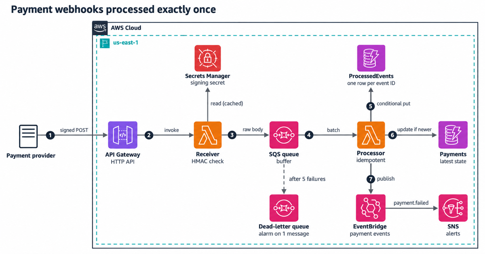

# Payment webhooks that run exactly once

Payment providers send webhooks at least once. A timeout on their side means they send the same event again, sometimes days later, and not always in order. This stack takes those webhooks on AWS and makes sure each event changes your data once.

It's written in AWS CDK (TypeScript) and tested end to end with in-memory fakes. There's also a smoke test you run against a real deploy.



## How it works

1. The provider POSTs a signed event to an Amazon API Gateway HTTP API.
2. The **receiver** Lambda function checks the HMAC-SHA256 signature over the raw body and rejects anything older than 5 minutes. It puts the verified body on an Amazon SQS queue and answers 200.
3. The **processor** Lambda function reads from the queue. For each event, it writes a row keyed by the event ID to DynamoDB with a conditional put. If the row already says COMPLETED, it skips the event.
4. It updates the payment in a second table, but only if this event is newer than the last one applied. A late, older event can't undo a newer state.
5. It publishes the event to an Amazon EventBridge bus for other services. Failed payments alert a person through Amazon SNS.
6. A message that fails 5 times goes to a dead-letter queue (DLQ), and an alarm fires.

## What it handles

Each row is a test in `test/flow/webhook-flow.test.ts`:

| Situation | What happens |
|---|---|
| Provider retries after a slow 200 | Second copy is skipped |
| Same event twice in one SQS batch | Processed once |
| Retry 3 days later | Still a duplicate (event IDs are kept 30 days) |
| Older event arrives after a newer one | Payment keeps the newer state, and nothing is published |
| EventBridge fails after the database write | Only that message is retried, and it publishes once |
| Worker dies while holding the lock | Lock expires after 2 minutes, and the next retry takes over |
| Forged or replayed request | 401, and nothing is queued |

## Deploy

You need Node.js 22 or newer, AWS credentials, and a CDK-bootstrapped account.

```bash
npm ci
npm run check                       # type check, tests, then synth with cdk-nag
npx cdk deploy -c alertEmail=you@example.com
```

Then put your provider's signing secret into AWS Secrets Manager. The stack prints the secret's ARN as `SigningSecretArn`.

```bash
aws secretsmanager put-secret-value --secret-id <SigningSecretArn> \
  --secret-string '{"current":"whsec_from_your_provider","previous":""}'
```

Give your provider the `WebhookUrl` output. Confirm the SNS email subscription so alarms reach you.

## Smoke test

The smoke test acts as the provider against your real stack. It sends a forged request, the same event three times, and an older event after a newer one, then checks DynamoDB:

```bash
npm run smoke
```

## Adapting it to your provider

The signature format (`t=...,v1=...`) follows the common provider pattern. If yours differs, change `lambda/shared/signature.ts`. If your provider's body uses other field names, change `lambda/shared/event.ts`. The tests show what each piece must do.

If you already use Powertools for AWS Lambda, its idempotency utility does the same job as `lambda/shared/idempotency.ts`. We wrote ours by hand so every condition is visible and tested.

## Cost

At low volume, this stack costs less than $1 a month outside the free tier. There's no VPC and no NAT Gateway. See [docs/cost.md](docs/cost.md) for the numbers and the sources.

## More docs

- [docs/security.md](docs/security.md): every security choice, and the ones we skipped
- [docs/runbook.md](docs/runbook.md): what to do when each alarm fires
- [docs/cost.md](docs/cost.md): monthly cost at 10,000 and 1 million events

## Clean up

```bash
npx cdk destroy
```

The `Payments` table is kept on purpose, so you don't lose payment state by accident. Delete it in the DynamoDB console when you're sure.

## Version 1

Version 1 of this repo accepted every webhook without checking the signature. It stored a new row on every retry, and it ran the functions in a VPC with a NAT Gateway they didn't need. Version 2 fixes all three. Don't use version 1.

---

Originally created by Rahul Ladumor / InfraTales
